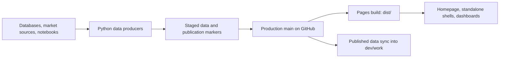

# Wicked Smart Bitcoin

[Live site](https://wickedsmartbitcoin.com) · [Repository](https://github.com/w-s-bitcoin/wickedsmartbitcoin)

Wicked Smart Bitcoin publishes interactive Bitcoin dashboards as a static website.
The browser reads committed CSV, JSON, binary, and JavaScript data files; separate Python
jobs produce and publish those datasets. You can work on the frontend using the
data already in a checkout, without a database or the production jobs.

For AI-assisted contributions, start with [AGENTS.md](AGENTS.md).
The detailed frontend guides are [js/js_README.md](js/js_README.md) and
[webapps/README.md](webapps/README.md).
The [shared dashboard standards](webapps/DASHBOARD_STANDARDS.md) define chart,
interaction, data, export, and review expectations for new work and incremental
updates to older dashboards.

**Quantum Exposure is deprecated and archived — 2026-10-06.** The dashboard
remains in the homepage grid with an Archived badge and at its direct URL,
with the frozen legacy snapshot at block **961000** and the
[archived findings](quantum_exposure_findings.html). No new Quantum snapshots
are scheduled, and the Quantum scheduler is not installed.

## Run locally

From the repository root:

```bash
python3 -m http.server 8080 --bind 127.0.0.1
```

Open [the homepage](http://127.0.0.1:8080/),
[a standalone dashboard](http://127.0.0.1:8080/node_count.html), or
[the dashboard iframe directly](http://127.0.0.1:8080/webapps/node_count/dashboard.html).
The generic visualization shell is available at
[view.html#node_count](http://127.0.0.1:8080/view.html#node_count).

Use HTTP rather than opening HTML through `file://`, because dashboards fetch
data files. Python's local server does not reproduce GitHub Pages' clean-route
fallback; use `.html` URLs locally.

There is no npm install or JavaScript bundling step. Python 3.10+ and Git are
needed for the portable checks below; browser regressions also need Chrome or
Chromium. Some pages load fonts or chart libraries from external services.
The homepage network KPIs use mempool.space's public block WebSocket to update
block height, the elapsed timer, and halving/difficulty countdowns on arrival.
The feed reconnects automatically and falls back to the public blocks REST API.
Published `assets/top_kpis.json` remains the fallback and actual supply anchor.
Between publications, issued supply adds the scheduled subsidies for intervening
blocks and is labeled estimated; a matching publication reconciles it. Failed
updates retain the last block and show the connection status.
BTC/USD prices in DCA Cost Basis, Days Since ATH, DCA Comparison, Moving Average, EOE Growth,
Unit of Account, and Bitcoin Net Worth use the public `wss://2140data.io/`
WebSocket. The 2140data.io `/price` endpoint is the first REST fallback. DCA,
Days, Comparison, Moving Average, and Unit of Account use the shared Coinbase
socket and public REST sources as the last fallback; Net Worth retains its
previous Kraken calculation. In DCA Cost Basis, each accepted
quote recalculates the current
UTC day's modeled purchase and the rolling cost basis; earlier purchase prices
remain fixed. The last accepted quote stays visible through feed outages until a
newer hourly publication replaces it. A green dot means a quote arrived within
60 seconds; a gray dot marks a retained or published price. Published hourly data supplies historical
playback and animation frames; an export ending at the latest published date
captures the newest available quote for its final frame and hold. The DCA
"Updated" follows the accepted quote and displays the published snapshot's
block height alongside it.
Days Since ATH uses the same BTC/USD feed on its dashboard and home card. Its
daily-high history stays published; the highest quote observed in the open tab
can raise today's provisional high or set a new ATH, while the latest spot price
drives the current drawdown and chart guide.
Historical playback remains published, and an export ending at the latest day
captures one quote for its final frame and hold.
Moving Average uses the same feed on its dashboard and home card to update the
current Bitcoin price and the selected moving average endpoints. Each line can
use a simple (SMA) or exponential (EMA) average of daily, Sunday, or calendar
month-end closes. Current SMA uses the current price and N−1 prior closes;
current EMA applies the current price once to the prior completed-period EMA
with weight `2 / (N + 1)`. The price represents the unfinished period, including
when the latest published price is the fallback.
When publication is one day behind, one provisional current-day row uses the
available published closes. Historical points and playback use completed closes;
SMA retains the reference average of N prior closes, while EMA weights recent
closes more heavily. Complete-window requirements and selectable period maximums
remain tied to the published history. Choosing None for the second line hides
its period/unit controls, KPI, and chart, expanding the first window. Price KPIs
show cents below $1 and dollars with two decimal places at $1 or above.
Bitcoin Net Worth also retains its last accepted price through an outage and
shows the latest published price when that snapshot is newer. Its quote status
turns gray after 60 seconds without an update.
DCA Comparison uses current BTC/USD and gold/silver quotes plus delayed public
quotes for SPY, QQQ, TLT, and MSTR. The selected assets' latest prices,
valuations, and chart update in an open tab; the home card updates its default
BTC/gold comparison. Equities are labeled with their feed delay (typically 15
minutes). If a feed drops, the tab retains its last quote with a gray status
dot until a newer published generation replaces it. Published daily prices
remain the historical source and the fallback on a fresh visit.
Unit of Account fetches USD quotes only for its selected pair. BTC uses the
shared spot feed, monetary metals use Gold API, and available fiat pairs use
indicative TradingView FX quotes. It calculates cross rates through USD and
updates the latest point in the open dashboard. Selected legs keep their
published value until a usable quote arrives; unsupported symbols stay on the
published snapshot. The Pair KPI shows each leg's quote status with a colored
dot; a dropped feed retains its last price until a newer publication wins.
Historical playback and exports use published data.

EOE Growth uses the shared live BTC/USD feed for its current view. It compares
the price with the historical sample nearest the timestamp of the block exactly
210,000 heights before the live mempool.space chain height. The published
chain snapshot remains the initial fallback; new blocks use the already
published historical lookup without waiting for a Pages deployment. Its lookup chunks are
generated from the existing block and ten-minute price CSVs during every Pages
build; the browser requests only the required 64 KiB chunk. Daily history loads
independently, and historical playback and earlier video frames remain daily.
Latest-date PNGs and final video frames refresh and freeze the current comparison;
the ending hold reuses that frame. Historical End dates stay historical.
For local EOE live references, run
`python3 scripts/build_eoe_live_reference.py` after updating the raw CSV inputs.

Issuance Rate uses the same public mempool block feed for its current dashboard
and home-card values. A complete, hash-linked recent block window supplies the
rolling 24-hour issuance calculation; after that initial catch-up, ordinary
blocks update directly from the WebSocket. Missed blocks and reorganizations
trigger a validated catch-up, with the last complete view retained on failure.
Historical rows, timezone histories, and custom datasets remain on the existing
node pipeline. See [Issuance's calculation and refresh notes](webapps/issuance_rate/README.md).
Price feeds continue using 2140data's WebSocket as their primary source.

Animation downloads use H.264 MP4 when the browser supports encoding at the
selected dimensions, with genuine WebM as the capability fallback. Both use
the shared deterministic frame sequence, export layout, and live-frame policy.
Every dashboard with animation download also offers a 2160-quality PNG of its
current view, using the selected orientation, theme, and shared creator and
Lightning donation footer.

## Architecture



The frontend uses ordinary HTML, CSS, and JavaScript. The homepage loads the
numbered `js/00_*.js` through `js/12_*.js` files in order; these scripts share
globals, so load order and shell DOM IDs are part of their interface.

`assets/image_list.json` supplies visualization metadata. Homepage bootstrap
code maps entries to dashboard embeds and previews. Each dashboard lives under
`webapps/<slug>/`, usually with `dashboard.html`, an application script,
a preview, and processed data. Root `<slug>.html` pages provide standalone
entry points. `view.html` is the generic shell and `404.html` supports
production clean routes.

Shared controls, chart helpers, export, theme/embedding behavior, and data
refresh live in `webapps/shared/`. Individual dashboards keep their own data
models and rendering code. Casascius uses `casascius_explorer.js` rather than
the usual `dashboard_app.js`; Quantum uses `standalone_app.js` for its
standalone controller.

### Data publication and refresh

A publication marker identifies a complete generation of data, often including
hashes of the exact payload files. Updaters publish payloads before their
markers. The browser prepares a candidate, validates it, rechecks its marker,
and only then installs it. Failed or superseded updates leave the last complete
generation visible.

Dashboard adapters use `webapp_data_auto_refresh.js`; homepage preview
adapters use `preview_shared.js`. Hidden previews can install data but defer
painting until visible. Theme and resize events render cached data. These
contracts preserve chart state and avoid reloads or flashing during updates.

Homepage fallback images refresh once per UTC day, on the first Pages
deployment after midnight UTC. That build captures both themes from the preview
renderers and packaged data; later builds reuse the day's saved images.
External live feeds are blocked during capture. The image can therefore lag
the current data by the rest of the day, while live previews still load the
latest published data and supported live quotes. Content-hashed filenames keep
browser caches current with each daily capture. The live preview fades over
the saved image in 200 ms (immediate with reduced motion). Capture failures
stop deployment, preserving the previous published site. Source fallback PNGs
and data producers are unchanged.

Pages builds run independently so a delayed older run cannot hold up a newer
publication. Each run builds its triggering commit, checks that it is still the
current `main` before checkout and artifact upload, and checks again after
waiting for deployment. Only Pages deployment is serialized; obsolete artifacts
are skipped and an active deployment is allowed to finish. All existing source,
publication, packaging, and daily-image checks remain in that path. GitHub runner
or Pages service delays can still occur, and a push during an active deployment
is picked up by the next eligible deployment.

### Repository map

| Path | Responsibility |
| --- | --- |
| `index.html`, `assets/styles.css`, `assets/homepage.css`, `js/` | Homepage, navigation, modal, preferences, published network snapshot |
| `<slug>.html`, `view.html`, `404.html` | Standalone pages and routing shells |
| `assets/` | Catalog, common imagery, shared published data and metadata |
| `webapps/shared/` | Shared dashboard and preview runtime |
| `webapps/<slug>/` | Dashboard code, previews, data, and producer scripts |
| `webapps/quantum_exposure/pipeline/` | Quantum research and snapshot production tools |
| `scripts/automation/` | Production hourly/onchain orchestration and Git deployment |
| `scripts/sync_main_data_to_dev.py` | Copies published data into the development worktree |
| `scripts/test_*.py` | Publication, Git synchronization, packaging, and browser regressions |
| `scripts/build_pages_dist.sh` | Creates the pruned static Pages artifact |
| `scripts/capture_card_fallbacks.py` | Captures validated dark/light homepage posters into the built artifact |
| `.github/workflows/` | Contributor checks and production Pages deployment |
| `dist/` | Generated Pages output; ignored by Git |

## Dashboards

| Route | Contents |
| --- | --- |
| `/node_count` | Node history and software/version distribution |
| `/bitcoin_dominance` | Bitcoin dominance and cryptocurrency market-cap comparisons |
| `/dca_cost_basis` | Bitcoin price and dollar-cost-average cost basis |
| `/moving_average` | Two configurable moving averages and trailing price windows |
| `/eoe_growth` | Bitcoin price paths aligned by halving-epoch block count and epoch-over-epoch growth |
| `/dca_comparison` | Equal-budget DCA comparisons between assets |
| `/days_since_ath` | All-time highs, drawdown, and time since the last high |
| `/issuance_rate` | Bitcoin issuance and halving history |
| `/uoa` | Historical currency-pair comparisons in both directions |
| `/bip110_signaling` | BIP-110 and historical SegWit signaling |
| `/patoshi_pattern` | Early-block ExtraNonce patterns and Patoshi classifications |
| `/quantum_exposure` | Archived Quantum research dashboard, frozen at block 961000 |
| `/casascius_explorer` | Physical coins/bars, mintage, redemption, and spend activity |
| `/bitcoin_net_worth` | Personal asset/liability tracking with local persistence and optional encryption |

Moving Average offers SMA and EMA with independently chosen periods and units.
Historical SMA points follow the reference notebook's N prior closes; EMA seeds
from the first N closes and updates recursively. Current endpoints include the
current price, so both methods update with every accepted quote. Window charts
show price and the enabled averages over their selected trailing windows;
disabling the second line expands the first window. See
[its calculation and refresh notes](webapps/moving_average/README.md).

Net Worth's personal records stay in browser storage or user exports. Do not
commit personal records or export files as dashboard fixtures.

Net Worth's title settings button controls the units offered in both valuation
and asset/liability dropdowns. Fresh preferences include USD, BTC, and sats;
additional currencies, cryptocurrencies, Bitcoin-related stocks, major ETFs, and metals
can be enabled individually. Stock and ETF amounts are share counts (including
fractional shares). Hiding a unit leaves existing holdings unchanged. These
controls also appear in the standalone `/bitcoin_net_worth` app. ETF choices cover
broad US/international equities, bonds, precious metals, and Bitcoin funds.

Crypto spot quotes use Coinbase and stock quotes use TradingView's public
scanner, with delays and retained prices labeled beside the dashboard. Only
units used by the view or holdings are requested. BTCFX uses CNBC's latest
daily NAV, labeled with its actual pricing date, and retains that price through
feed outages. Historical stock valuations
use dated saved prices, carried forward until another saved price is available;
they do not use split-adjusted comparison data. Enter a price for the selected
date with **Set a price** when needed. Unavailable prices show a dash in affected
totals and omit unpriced dates from charts. CSV and encrypted exports preserve
quantities, units, BTC/USD, and saved per-unit USD prices; older files still load.

For today's holdings, a manual Bitcoin price applies the same percentage change
to estimated MSTR and Bitcoin fund prices, including BTCFX and Bitcoin ETFs.
Other stocks and funds keep their own prices. Automatic or manually set share
prices serve as the base; saved quotes and history retain their original prices.
Totals, charts, filters, and share units of account use the estimates together.

UoA pair links accept `?pair=BTCEUR` on `/uoa` (or `/uoa.html` locally).
The first three letters select the primary account and the last three select
the secondary account. Both codes must be supported and distinct; the link
opens that pair even when a different pair was saved in the browser.

Copy Link on the analytics dashboards captures the complete view, including
default values, filters, selected series, units, scales, date/snapshot selection,
and paused playback position where supported. Opening a copied link takes
precedence over the recipient's saved dashboard settings. Links recreate the
view using the available published/live data; they do not freeze market quotes.
Bitcoin Net Worth retains its existing sharing and personal-data behavior.

## Production data jobs

Production orchestration is documented in
[scripts/automation/README.md](scripts/automation/README.md). These programs can
access local credentials, update datasets, commit, and push to GitHub. They are
not required to serve or test the frontend.

- The hourly runner updates shared Bitcoin metrics, Node Count, Dominance,
  DCA Cost Basis, DCA Comparison, UoA, Patoshi, and Casascius data.
- The onchain runner is called after block ingestion by the external
  `CoreToPSQL` pipeline. It handles signaling/top-KPI publication when
  applicable and issuance data. It takes priority over hourly deployment.
- The retired Quantum producer and its
  [operating guide](webapps/quantum_exposure/pipeline/OPERATIONS_V2.md) remain
  in the repository for historical reference. They are not part of the hourly
  runner or block ingestion.
- Historical animation cleanup and its disabled daily job remain external.

The production checkout normally uses `main`; the separate development
worktree uses `dev/work`. Production automation may amend its latest
`Update data` commit and push with a lease. Generated publications use the
`WSB Data Sync` author and committer identity. The dev sync helper prepares a
data-only snapshot rather than replaying rewritten history. A clean checkout
whose full tree matches the published main commit reuses that commit, avoiding
an accumulating chain of redundant development snapshots. Otherwise it keeps
the snapshot, preserves staged and unstaged development edits and untracked
files, and defers updates that overlap dirty data paths. This sync does **not**
merge source-code changes from main.
Always inspect the current branch and worktree before Git operations.

## Validation

Run the portable contributor checks from the repository root:

```bash
bash scripts/check_project.sh
```

This runs dashboard contracts, shell syntax and whitespace checks, isolated
Git/deployment and Pages-build regressions, and publication-marker validation.
It does not contact production databases or run the production jobs. Pull
requests run these checks, and the Pages workflow runs them before building.

Use the narrower checks when working on a specific area:

| Change | Relevant command |
| --- | --- |
| Dashboard markup/shared wiring | `bash scripts/check_all_dashboards.sh` |
| One dashboard contract | `bash scripts/check_dashboard_contract.sh webapps/<slug>` |
| Dev data synchronization | `python3 -m unittest scripts.test_sync_main_data_to_dev` |
| Basic browser document loading | `bash scripts/smoke_dashboards.sh webapps/<slug>` |
| Refresh/state behavior | The matching browser regression below |

The smoke script is a document-load check; it does not establish chart or
refresh correctness. It excludes Casascius from its default run because that
dashboard has a different shell contract.

Browser regressions launch an isolated browser profile and local server. Set
`CHROME_BIN` if Chrome is not at the default macOS path:

```bash
CHROME_BIN=/path/to/chromium python3 scripts/test_stage1_refresh_atomicity.py
CHROME_BIN=/path/to/chromium python3 scripts/test_stage2_refresh_atomicity.py
CHROME_BIN=/path/to/chromium python3 scripts/test_stage3_incremental_refresh.py
CHROME_BIN=/path/to/chromium python3 scripts/test_stage4_live_refresh.py
node scripts/test_dca_live_price.mjs
CHROME_BIN=/path/to/chromium python3 scripts/test_dca_live_price_browser.py
node --test scripts/test_moving_average_model.mjs
node --test scripts/test_eoe_growth_model.mjs
node --test scripts/test_eoe_growth_live.mjs
node --test scripts/test_issuance_live.mjs
CHROME_BIN=/path/to/chromium python3 scripts/test_dashboard_chain_live_browser.py
node --test scripts/test_calendar_ticks.mjs
node --test scripts/test_export_branding.mjs
node --test scripts/test_export_footer_integration.mjs
node --test scripts/test_mp4_muxer.mjs scripts/test_video_encoder.mjs
CHROME_BIN=/path/to/chromium python3 scripts/test_video_export_browser.py
# Optional full Patoshi benchmark: 10m34s, 19,021 frames per codec (requires FFmpeg).
CHROME_BIN=/path/to/chromium python3 scripts/test_video_export_browser.py --long --output-dir /tmp/wsb-video-long-review
CHROME_BIN=/path/to/chromium python3 scripts/test_export_footer_browser.py
CHROME_BIN=/path/to/chromium python3 scripts/test_export_footer_browser.py --images-only
node --test scripts/test_scale_transitions.mjs
CHROME_BIN=/path/to/chromium python3 scripts/test_dca_scale_browser.py
CHROME_BIN=/path/to/chromium python3 scripts/test_days_issuance_scale_browser.py
CHROME_BIN=/path/to/chromium python3 scripts/test_uoa_casascius_scale_browser.py
CHROME_BIN=/path/to/chromium python3 scripts/test_moving_average_browser.py
CHROME_BIN=/path/to/chromium python3 scripts/test_moving_average_export_browser.py
CHROME_BIN=/path/to/chromium python3 scripts/test_eoe_growth_browser.py
CHROME_BIN=/path/to/chromium python3 scripts/test_eoe_growth_live_browser.py
CHROME_BIN=/path/to/chromium python3 scripts/test_dashboard_control_parity.py
node scripts/test_days_live_price.mjs
CHROME_BIN=/path/to/chromium python3 scripts/test_days_live_price_browser.py
node scripts/test_comparison_live_price.mjs
CHROME_BIN=/path/to/chromium python3 scripts/test_comparison_live_price_browser.py
CHROME_BIN=/path/to/chromium python3 scripts/test_networth_live_quote_browser.py
node scripts/test_networth_market_units.mjs
CHROME_BIN=/path/to/chromium python3 scripts/test_networth_units_browser.py
node scripts/test_uoa_live_quotes.mjs
CHROME_BIN=/path/to/chromium python3 scripts/test_uoa_live_quotes_browser.py
CHROME_BIN=/path/to/chromium python3 scripts/test_homepage_preview_refresh.py
CHROME_BIN=/path/to/chromium python3 scripts/test_homepage_kpis_browser.py
node --test scripts/test_bitcoin_chain_tip.mjs
CHROME_BIN=/path/to/chromium python3 scripts/test_card_fallbacks_browser.py
node scripts/test_dashboard_share.mjs
CHROME_BIN=/path/to/chromium python3 scripts/test_dashboard_share_routes.py
CHROME_BIN=/path/to/chromium python3 scripts/test_time_series_share_browser.py
CHROME_BIN=/path/to/chromium python3 scripts/test_analytics_share_browser.py
CHROME_BIN=/path/to/chromium python3 scripts/test_specialized_share_browser.py
```

Read each script's docstring for targets and optional arguments. Run the suites
relevant to the change; a documentation edit does not need every browser test.
The archived Quantum browser tests remain available for explicit historical checks.
UoA producer-window tests additionally need pandas:
`python3 -m unittest scripts.test_uoa_refresh_windows` (skipped if pandas is unavailable).

To inspect the actual deployment artifact:

```bash
bash scripts/build_pages_dist.sh
python3 -m http.server 8081 --bind 127.0.0.1 --directory dist
```

The build replaces `dist/`. It copies browser assets, excludes pipeline code
and selected raw inputs, and removes large Quantum archive payloads while
keeping coherent empty archive catalogs. Compact historical snapshots remain;
the current snapshot retains its full address table. The source tree and the
Pages artifact intentionally contain different datasets.

The first build each UTC day requires Chrome/Chromium to capture homepage
images; set `CHROME_BIN` if it is not discoverable on PATH or at the usual macOS
path. Pages CI uses its Ubuntu runner's Chrome and caches the images in
`.cache/card-fallbacks` under an exact UTC-date key, with no prior-day restore.
Local builds use the same cache directory by default; set
`WSB_CARD_FALLBACK_CACHE_DIR` to choose another location. The generator also
checks the cache manifest's UTC date before reuse.

A fresh capture renders all 14 preview pages at 1280×720 in both themes using
only packaged files. Every build installs the day's hashed poster URLs and
versions the homepage script containing that map. Later deployments that day
reuse the images and skip the capture-specific browser check, reducing build
time while still publishing current data. Cards added later that day use their
committed fallback until the next day's capture. An unavailable or timed-out preview
during a fresh capture fails the build before the artifact is uploaded. The
explicit `--skip-card-fallbacks` option is for browser-free packaging fixtures
only and is never used by the deployment workflow.

## Adding a dashboard

Start with [DASHBOARD_TEMPLATE.md](DASHBOARD_TEMPLATE.md) and
[webapps/README.md](webapps/README.md), then run:

```bash
bash scripts/create_dashboard.sh example_dashboard "Example Dashboard"
bash scripts/check_dashboard_contract.sh webapps/example_dashboard
```

The generator creates starter files, including a manifest and a root redirect.
Complete the rendering, preview, data producer, catalog/bootstrap registration,
and standalone integration as needed. Follow an existing dashboard with similar
behavior and reuse shared controls and refresh helpers. Check packaging whenever
new runtime filenames or data dependencies are introduced.

## Donation

Lightning address: `wicked@primal.net`


## License

Wicked Smart Bitcoin is fully open source / FOSS.

Unless otherwise noted, all code, dashboard source, data update scripts,
generated dashboard data, and documentation in this repository are released
under the MIT License.

© 2025-2026 Wicked Smart Bitcoin.
